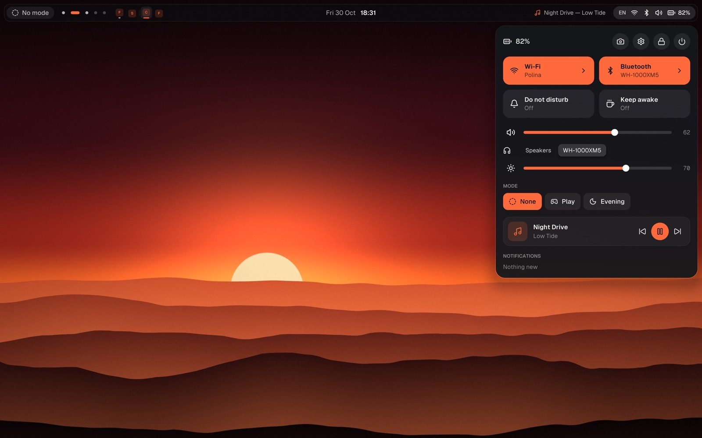
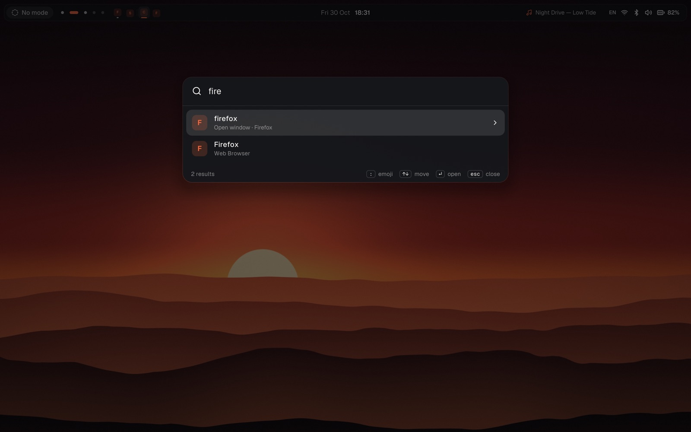
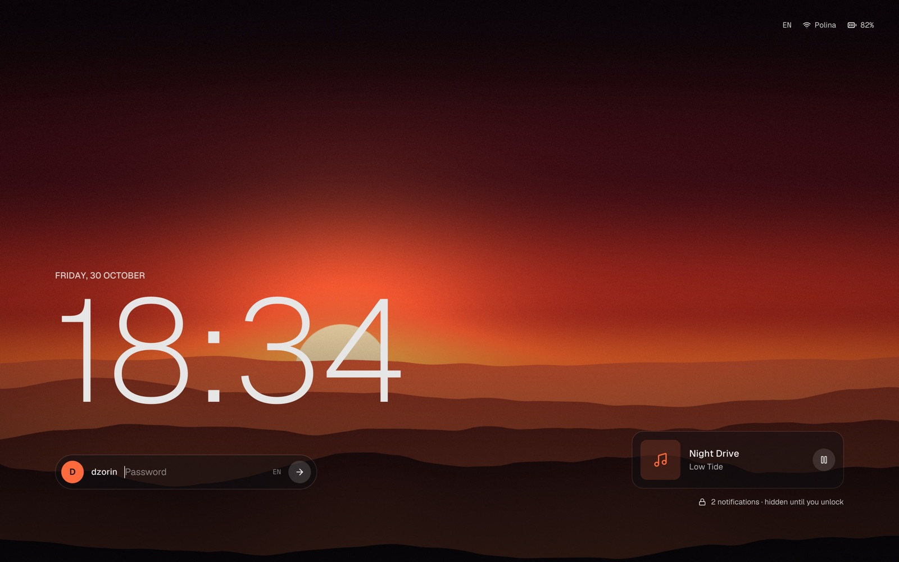
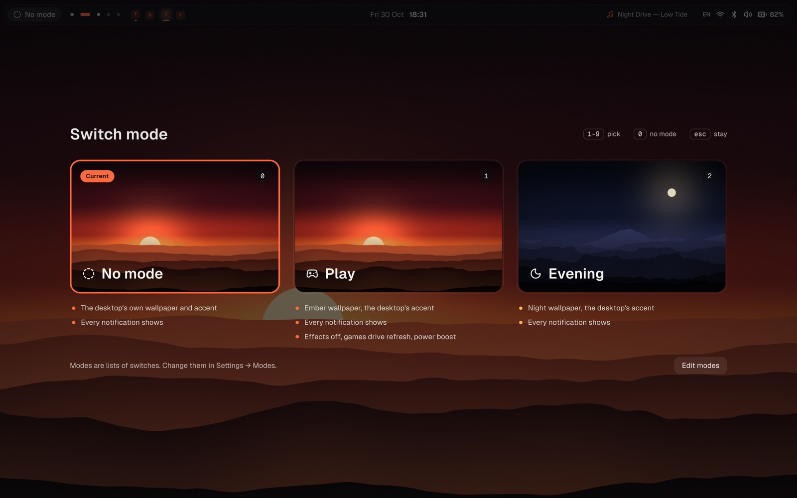
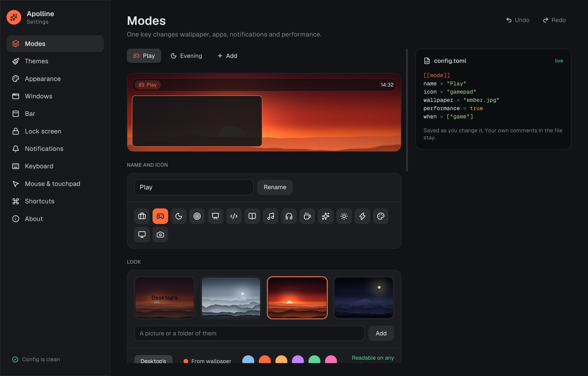
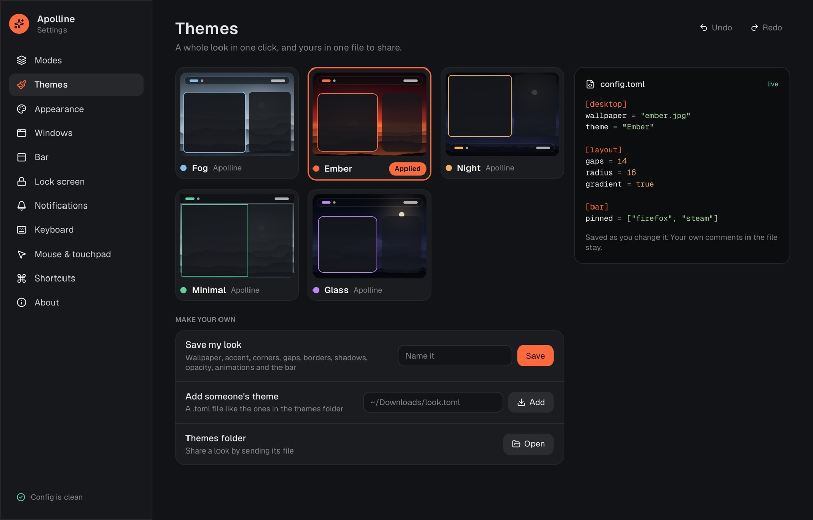

# Apolline

A desktop shell for [niri](https://github.com/YaLTeR/niri): bar, launcher, quick settings, notifications, clipboard history, lock screen, polkit agent and a settings window, made to look finished on the first login. Modes are optional: make your own and one key, or a game starting, the battery, the clock or a monitor, switches wallpaper, accent, notifications, apps, performance and even the shortcuts.

At rest the shell wakes once a minute, for the clock; everything else arrives as an event, and the config, sound and network are watched in the background without repainting. In a VM with no GPU that is 0.2–0.4% CPU. When the GPU renderer can't start, every surface falls back to drawing on the CPU, so the lock screen still comes up.

Early days. Inside a Wayland session on Linux it draws the wallpaper and the bar as layer-shell surfaces; anywhere else it opens a preview window. Under [niri](https://github.com/YaLTeR/niri) the bar shows live workspaces and the keyboard layout, and a click on a workspace switches to it. Battery comes from UPower and the playing track from any MPRIS player. Arch first.



| | |
|---|---|
|  |  |
|  |  |
|  | |

## Install on Arch

```sh
cd packaging/arch && makepkg -si   # apolline-git: the binary, the PAM file, the settings entry and icon
apolline setup                     # once, as your user: adds Apolline to your niri config
```

## Try it

```sh
cargo run -p apolline-shell                    # layer-shell session under Wayland, preview window elsewhere
cargo run -p apolline-shell -- --preview       # always a window: 1/2/3 modes, m switcher, space launcher, q quick settings
cargo run -p apolline-shell -- --preview --open launcher
cargo run -p apolline-shell -- settings        # the settings app, or settings --page keyboard
cargo run -p apolline-shell -- lock --preview  # the lock screen in a window
cargo run -p apolline-shell -- check           # validate ~/.config/apolline/config.toml
cargo run -p apolline-shell -- --mode play --screenshot shot.png
tools/headless.sh shot.png --mode play         # Linux: the real session under a headless sway, saved with grim
tools/fake-controls.sh ~/fakebin               # stand-in wpctl, nmcli, bluetoothctl, brightnessctl for quick settings
```

## With niri

```sh
apolline setup
```

It writes Apolline's niri fragment to `~/.config/apolline/niri.kdl` and adds one `include` line at the end of your niri config, after saving a copy of it. The fragment starts Apolline with the session, matches window gaps, borders and corners to the shell, puts the wallpaper behind the overview, opens the settings window floating, and binds these keys:

| Key | Opens |
|---|---|
| `Mod+Space` | the launcher: apps and games from `.desktop` files (Steam games included), open windows, sums like `15% of 340` (Enter copies the answer), `:emoji` by name, `/files` in your home, modes, settings, lock |
| `Mod+A` | quick settings: Wi-Fi, Bluetooth, do not disturb, keep awake, volume, brightness, mode, the player, past notifications, screenshot, power |
| `Mod+Shift+M` | the mode switcher |
| `Mod+Alt+V` | clipboard history |
| `Mod+/` | every shortcut, Apolline's and niri's, searchable |
| `Super+Alt+L` | the lock screen, instead of swaylock |

Change them in settings → Shortcuts, which also tells you what each one replaces in your niri config. Quick settings use `wpctl` (PipeWire), `brightnessctl`, `nmcli` (NetworkManager) and `bluetoothctl`; whatever is missing just isn't shown.

## Windows

niri's own Alt+Tab shows live previews of recent windows; Apolline colors it with the accent and rounds it like the windows (Alt+` stays within one app). The bar shows the windows of the current workspace: click to focus, middle click to close. Pinned apps sit before them: a click jumps to the app's window, or starts it; right-click any icon on the bar to pin or unpin it (`[bar] pinned = ["firefox", "steam"]`).

Settings → Windows, or `[windows]` in the config: the width new windows open at, the widths `Mod+R` cycles through, centering, focus follows mouse, the opacity of focused and other windows, and animation speed. `[[rule]]` entries do the same per app:

```toml
[windows]
inactive_opacity = 0.85
animations = 1.5           # 0 turns them off, 2 is twice as fast

[[rule]]
app = "pavucontrol"        # the app id from `niri msg windows`
floating = true
width = "1/3"
opacity = 0.95
```

Nothing in `[windows]` is written to niri until you set it, so your niri config keeps deciding the rest.

## Themes

A theme is one small file: wallpaper, accent, gaps, corners, borders, shadows, window opacity, animation speed and the bar's place and look. Settings → Themes shows them as a gallery: five come with Apolline (Fog, Ember, Night, Minimal, Glass), *Save my look* turns your current setup into one, and *Add someone's theme* takes a file somebody sent you. They live in `~/.config/apolline/themes`, so sharing a look is sending a file.

```sh
apolline theme            # list them, the applied one marked
apolline theme Glass      # apply one
apolline theme next       # the next one, handy on a key
```

```toml
[theme]
name = "Glass"
author = "Apolline"

[desktop]
wallpaper = "night.jpg"
accent = "#c084fc"         # or "auto": picked from the wallpaper

[layout]
gaps = 16
radius = 18

[windows]
inactive_opacity = 0.8

[bar]
position = "top"           # or "bottom"
floating = true            # or edge to edge
opacity = 0.3
```

Themes can also carry the eye candy: `gradient = true` in `[layout]` lets the focused border flow across the workspace, and in `[windows]` `motion` is `snappy`, `smooth` or `bouncy`, `appear` is `pop`, `slide` or `fade`, and `blur` is `wallpaper` or `all` for see-through windows; `[bar] blur = true` frosts the bar. Performance modes turn all of it off.

Applying a theme rewrites only these keys in your config and leaves the rest alone. With `accent = "auto"` and your own wallpaper, the accent is the picture's most present vivid color, softened to sit next to the built-in accents and lightened until it reads on the bar's glass; window borders in niri follow it.

## Apps in your colors

`[apps] colors = true`, or *Color apps too* in Settings → Appearance, gives GTK 3, GTK 4 and Qt apps (through qt6ct) your accent and the dark style, and follows your modes. It writes `apolline.css` next to your `gtk.css`, adds one `@import` line to the top of `gtk.css`, a qt6ct palette, and the GNOME `color-scheme` and nearest `accent-color`. Turning it off removes exactly that. A `gtk.css` that is a link (dotfiles managers) is left alone; Apolline tells you the line to add yourself.

Wallpapers come from `~/.local/share/apolline/wallpapers`, `~/Pictures/Wallpapers` and any folder you add in Settings → Appearance (`[desktop] folders`). `[desktop] rotate = 60` moves through them every hour (`shuffle = true` for random order); the file keeps the one you picked, and the lock screen shows the current one. With more than one monitor, Settings → Appearance lets each have its own picture (`[desktop] outputs = { "HDMI-A-1" = "wide.jpg" }`); a mode's wallpaper still covers them all.

## Modes

There are none until you make one, in Settings → Modes from a template (Work, Play, Evening, Focus, Presentation) or from nothing, or as `[[mode]]` in the config. A mode can change the wallpaper and accent, hold back notifications, open apps, keep the screen awake, add **its own shortcuts** that exist only while it's on, and turn on performance.

Switch from the bar, quick settings, the launcher, `Mod+Shift+M`, or `apolline mode NAME|next|none`. A mode can also switch itself on:

```toml
[[mode]]
name = "Play"
when = ["game"]                  # Steam, Proton, gamescope or Wine running

[[mode]]
name = "Evening"
when = ["20:00-07:00", "battery", "monitor HDMI-A-1"]
```

When the reason ends, the mode you had before comes back. Triggers act only when something changes, so switching by hand always wins. A switch recolors window borders, opens the mode's apps that aren't running yet and rewrites the mode's keys into niri.

Performance turns off animations and window shadows, lets games (Steam and Proton, gamescope, Wine) drive the monitor's variable refresh rate, and sets the power profile to performance — and back to what it was when you leave, unless you changed it yourself in between. Variable refresh rate is set for monitors your niri config doesn't already describe; for those, add `variable-refresh-rate on-demand=true` to their `output` block.

## Lock screen

`apolline lock` locks the session with ext-session-lock: the time, your name and a password field, what's playing, how many notifications wait, and the keyboard layout right next to the password. It is a separate process, so if it ever crashes the session stays locked; run `apolline lock` again from a TTY to get the password field back.

The shell also locks on `loginctl lock-session`, right before the laptop sleeps, and after five idle minutes; the screen goes off at ten, and 30 seconds after locking. Video players that keep the screen awake are respected, modes with *keep the screen awake* (Play has it, since a gamepad doesn't count as input) skip it, and *keep awake* in quick settings holds everything off. All of it lives in `[lock]` and `[idle]`. Passwords go through PAM: install [`assets/pam/apolline`](assets/pam/apolline) as `/etc/pam.d/apolline`, or the `login` service is used.

## Admin passwords

Apolline is a polkit agent: when an app needs an admin password (pkexec, GParted, package managers), the request shows up as an Apolline dialog with the users who may approve it. It talks to polkit's socket-activated helper and falls back to the setuid one. If another agent (polkit-gnome, hyprpolkitagent) is already running, Apolline steps aside.

## Notifications

Apolline is a notification daemon too, unless another one (mako, dunst, …) already holds the name — then it stays out of the way. Without a mode everything shows; each mode can show all, hold the low-priority ones, or let only urgent ones (calls, alarms) through, and do not disturb holds everything but urgent anywhere. Held notifications wait behind a counter in the bar and come out when you switch to a mode that allows them. Everything that arrived is kept in quick settings, newest first, until you clear it.

## Settings

`apolline settings` covers modes, themes, window look and motion, the bar, the lock screen and idle, notifications, keyboard layouts and repeat, touchpad and mouse, shortcuts, and a health check of the config — with switches instead of syntax and a live preview where it helps. Every change is saved right away and the shell picks it up; the panel on the right shows exactly what was written. It edits the file in place, so your own comments and order stay, and it refuses to touch a file it can't parse. Ctrl+Z and Ctrl+Shift+Z step through every saved version, a theme switch included. On the very first start, with no config yet, it opens on a welcome page: connect to niri, pick a look, add modes if you like, and the keys worth knowing.

## Config

Keyboard, touchpad and mouse stay with your niri config until you set them in Apolline; after that Apolline writes them into its niri fragment.

The config is forgiving and live: changes apply as soon as you save, a typo shows up as a card with the line and a suggestion, and everything else still applies. The card goes away when you fix it. See [`assets/config.toml`](assets/config.toml).

The three default wallpapers are built into the binary; point `wallpaper` at your own file to use something else.

## Layout

| Path | What |
|---|---|
| `crates/theme` | colors and sizes, the accent picked from a wallpaper, contrast-checked in tests |
| `crates/config` | config model and its parser |
| `crates/niri` | niri IPC protocol and the state it describes, no I/O |
| `crates/shell` | the `apolline` binary: shared core, preview window, layer-shell session |
| `assets/` | wallpapers, Geist fonts (OFL), the default config, the niri fragment |
| `assets/themes` | the five bundled themes |
| `assets/icons` | the Lucide icons Apolline uses (ISC) |
| `assets/pam`, `assets/*.desktop`, `assets/apolline.svg` | what a package installs next to the binary |
| `packaging/arch` | the `apolline-git` PKGBUILD |
| `tools/` | wallpaper generator, headless screenshot script, stand-ins for MPRIS, UPower, power profiles and the quick settings tools |

## License

MIT or Apache-2.0, at your option ([`LICENSE-MIT`](LICENSE-MIT), [`LICENSE-APACHE`](LICENSE-APACHE)). Geist is under the OFL, the icons come from Lucide (ISC).
