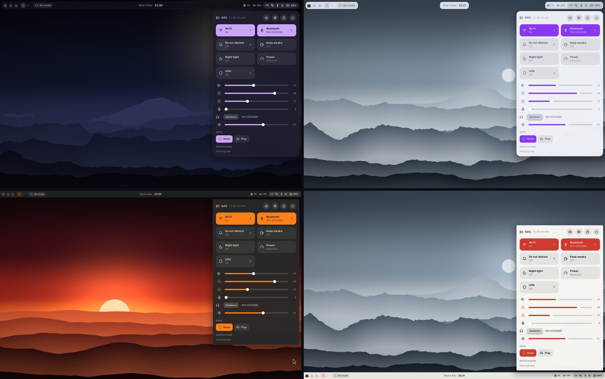
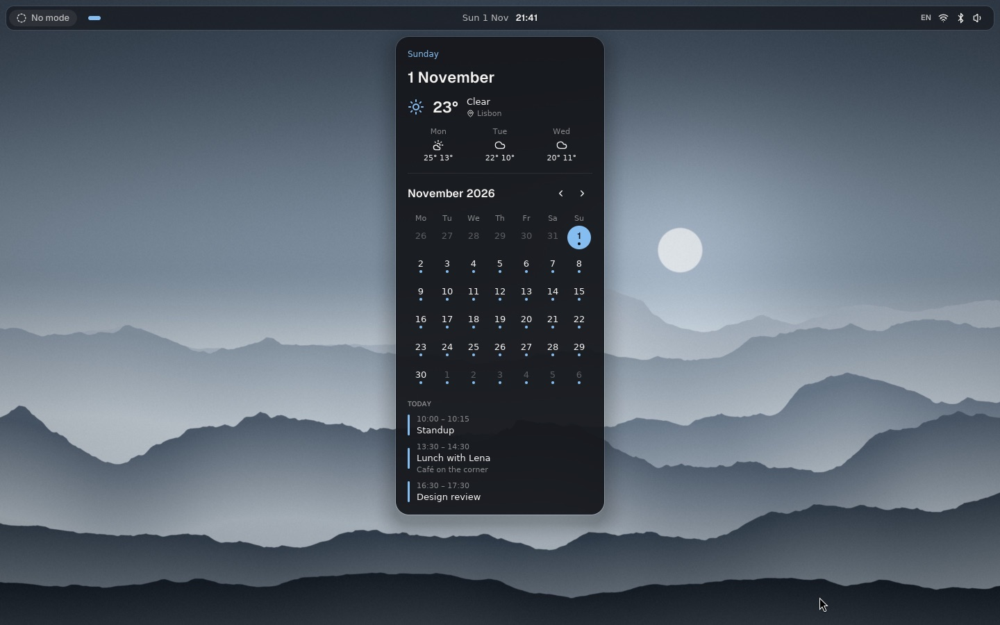
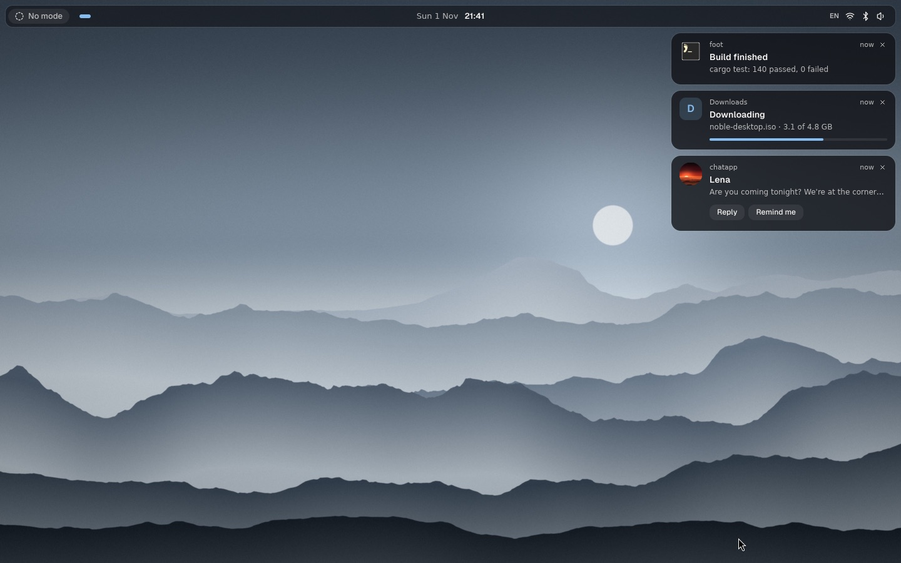
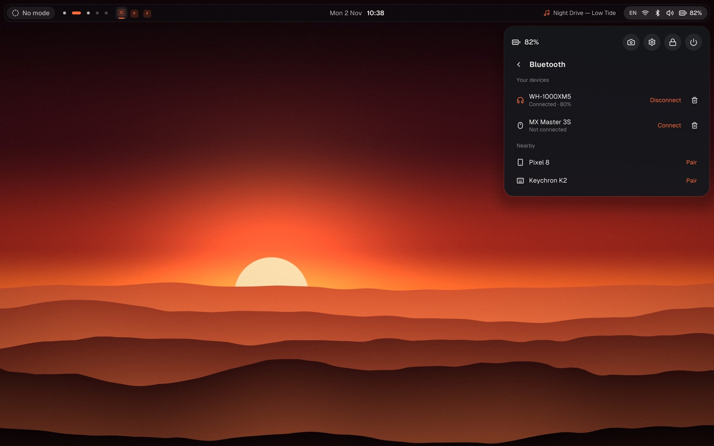
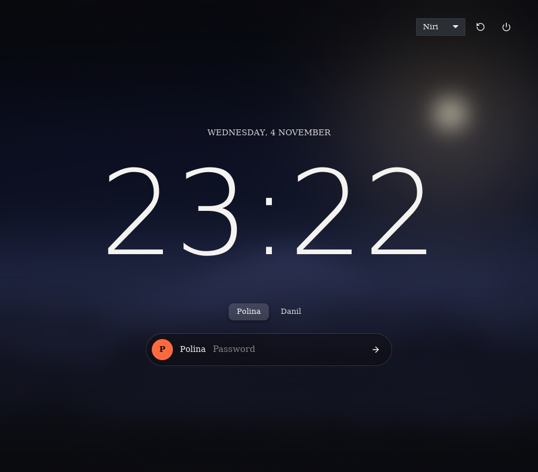
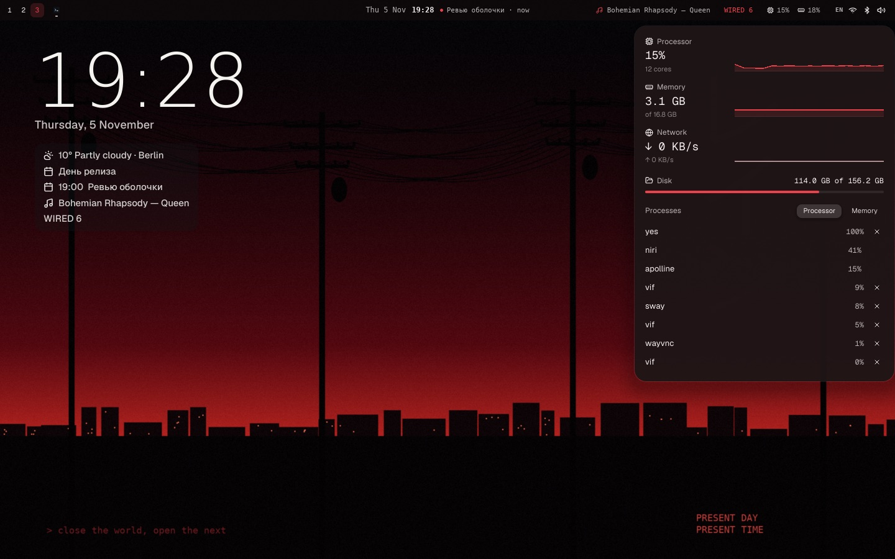
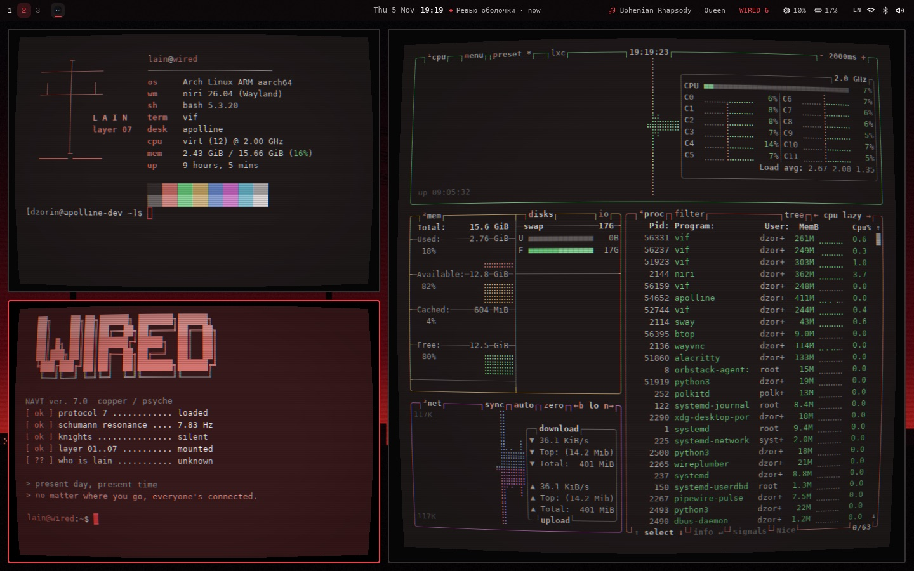

# Apolline

A desktop shell for [niri](https://github.com/YaLTeR/niri): bar, launcher, quick settings, notifications, clipboard history, lock screen, polkit agent and a settings window, made to look finished on the first login. Modes are optional: make your own and one key, or a game starting, the battery, the clock or a monitor, switches wallpaper, accent, notifications, apps, performance and even the shortcuts.

At rest the shell wakes once a minute, for the clock; everything else arrives as an event, and the config, sound and network are watched in the background without repainting. In a VM with no GPU that is 0.2–0.4% CPU. When the GPU renderer can't start, every surface falls back to drawing on the CPU, so the lock screen still comes up.

Early days. Inside a Wayland session on Linux it draws the wallpaper and the bar as layer-shell surfaces; anywhere else it opens a preview window. Under [niri](https://github.com/YaLTeR/niri) the bar shows live workspaces and the keyboard layout, and a click on a workspace switches to it. Battery comes from UPower and the playing track from any MPRIS player. Arch first.



| | |
|---|---|
|  |  |
|  |  |
|  |  |
|  |  |
|  |  |
|  |  |

A whole rice to start from, wallpaper and terminals included, is in [examples/wired](examples/wired).

## Install on Arch

Apolline's terminal is [vif](https://github.com/Pisosenie/vif), so it goes first (`vif-bin` is the prebuilt one):

```sh
git clone https://github.com/Pisosenie/vif && cd vif/packaging/arch/vif && makepkg -si
```

```sh
cd packaging/arch/apolline && makepkg -si   # the latest release; apolline-git builds main
apolline setup                              # once, as your user: adds Apolline to your niri config
                                            # (and comments out niri's stock waybar line, so there's one bar)
apolline doctor                             # what works here, and what to install for the rest
```

## Try it

```sh
cargo run -p apolline-shell                    # layer-shell session under Wayland, preview window elsewhere
cargo run -p apolline-shell -- --preview       # always a window: 1/2/3 modes, m switcher, space launcher, q quick settings
cargo run -p apolline-shell -- --preview --open launcher
cargo run -p apolline-shell -- settings        # the settings app, or settings --page keyboard
cargo run -p apolline-shell -- lock --preview  # the lock screen in a window
cargo run -p apolline-shell -- check           # validate ~/.config/apolline/config.toml
cargo run -p apolline-shell -- --mode play --screenshot shot.png
tools/headless.sh shot.png --mode play         # Linux: the real session under a headless sway, saved with grim
tools/fake-controls.sh ~/fakebin               # stand-in wpctl and brightnessctl for quick settings
tools/fake-bus.sh                              # fake NetworkManager, BlueZ, fprintd, UPower and power profiles on a bus of their own
```

## With niri

```sh
apolline setup
```

It writes Apolline's niri fragment to `~/.config/apolline/niri.kdl` and adds one `include` line at the end of your niri config, after saving a copy of it. The fragment starts Apolline with the session, matches window gaps, borders and corners to the shell, puts the wallpaper behind the overview, opens the settings window floating, and binds these keys:

| Key | Opens |
|---|---|
| `Mod+Space` | the launcher: apps and games from `.desktop` files (Steam games included) and what they offer besides (`private` or `firefox new` finds Firefox's new private window), open windows, sums like `15% of 340`, units like `10 km in mi` and money like `100 usd in eur` (today's rates from ExchangeRate-API, asked for only when you type a sum of money; Enter copies the answer), `:emoji` by name, `/files` in your home, screenshots of an area, the screen or the window, a color picker, screen recording (with wf-recorder), modes, settings, lock. What you start often and lately comes first, and a search that finds nothing offers to run it as a command or look it up on the web |
| `Mod+T` | the terminal, vif unless `[apps] terminal` names another; console apps like htop and the launcher's commands open in it too |
| `Mod+A` | quick settings: Wi-Fi, Bluetooth, do not disturb, keep awake, night light, power profile, VPN and WireGuard tunnels saved in NetworkManager, volume, each app playing with a level of its own, the microphone, brightness, mode, the player, past notifications, screenshot, power |
| `Mod+Shift+M` | the mode switcher |
| `Mod+Alt+V` | clipboard history: kept in memory only, except what you pin, which stays in `~/.local/share/apolline/pinned.json` (readable only by you); password managers' secrets are never kept |
| `Mod+/` | every shortcut, Apolline's and niri's, searchable |
| `Super+Alt+L` | the lock screen, instead of swaylock |

Change them in settings → Shortcuts, which also tells you what each one replaces in your niri config. Quick settings use `wpctl` (PipeWire) and `brightnessctl`, hear about volume changes from `pactl subscribe`, and talk to NetworkManager and BlueZ over D-Bus; whatever is missing just isn't shown.

After any screenshot, niri's own Print keys included, a card offers to mark it: arrows, boxes, a pen, a marker, text, numbered steps, and a patch over what shouldn't show, in that part's average tone so nothing under it can be read back; with a part hidden, the marked picture also replaces niri's copy of the original on the clipboard. Enter copies the result and saves it next to the original as `… marked.png`; Ctrl+C and Ctrl+S do one or the other, Ctrl+Z takes back the last mark, and P, A, B, M, T, N, H pick the tool; with text, a click starts it, Enter places it and Esc drops it. "Mark the last screenshot" in the launcher opens the last one niri told Apolline about, or the newest in `~/Pictures/Screenshots`.

A mode can keep the last moments: `replay = 30` (or Settings → Modes → Keep the last moments, 15 s to 2 min) runs [gpu-screen-recorder](https://git.dec05eba.com/gpu-screen-recorder/about/) in replay mode while the mode is on, the screen and the sound in memory, nothing on disk; Mod+Alt+R (`[shortcuts] replay`, or `apolline replay`) saves them to `~/Videos/Replays`. The Play mode Apolline suggests keeps 30 seconds. Without gpu-screen-recorder nothing happens and `apolline doctor` says what to install.

## Windows

niri's own Alt+Tab shows live previews of recent windows; Apolline colors it with the accent and rounds it like the windows (Alt+` stays within one app). The bar shows the windows of the current workspace: click to focus, middle click to close. Pinned apps sit before them: a click jumps to the app's window, or starts it; right-click any icon on the bar to pin or unpin it (`[bar] pinned = ["firefox", "steam"]`). Drag a pinned app to move it, drag a window among the pinned apps to pin it right there, and drag a pinned app well past the others to unpin it.

Settings → Windows, or `[windows]` in the config: the width new windows open at, the widths `Mod+R` cycles through, centering, focus follows mouse, the opacity of focused and other windows, and animation speed. `[[rule]]` entries do the same per app:

```toml
[windows]
inactive_opacity = 0.85
animations = 1.5           # 0 turns them off, 2 is twice as fast

[[rule]]
app = "pavucontrol"        # the app id from `niri msg windows`
floating = true
width = "1/3"
opacity = 0.95
```

Nothing in `[windows]` is written to niri until you set it, so your niri config keeps deciding the rest.

## Surfaces your way

`[style.bar]` (or Settings → Bar) sets the bar's `size`, its height with the text and icons in it, and the `radius` of its island. `[style.launcher]`, `[style.panel]`, `[style.notifications]` and `[style.osd]` (or Settings → Appearance) set `radius`, `opacity` and `size` (0.8 to 1.5, text and spacing together) for the launcher, quick settings, notification cards and the volume and brightness popup; `[notifications] position` puts the cards in any corner or the middle of the top or bottom edge (`top-left`, `top`, `top-right`, `bottom-left`, `bottom`, `bottom-right`), the newest nearest the edge; `grid = true` in `[style.launcher]` shows apps as a grid of big icons, moved through with all four arrows. Each of these takes a `font` too, the family name as `fc-list` gives it, so the bar can be monospace and quick settings serif while the rest keeps `[desktop] font`; unlike that one, it changes at once. `[launcher] finds` lists where the launcher looks: `apps`, `windows`, `modes`, `actions`, `calculator`, `files`, `emoji`, `run` and `web`, all of them as it comes; `web = "https://www.startpage.com/do/search?q={query}"` sends web searches somewhere other than DuckDuckGo (Settings → Appearance → The launcher).

`timer 25m tea` in the launcher (or `таймер 10 мин`, `timer 1h30m`, `apolline timer 5m` from a script) starts a countdown that shows on the bar next to the recording dot and rings with a card when it's done, through do not disturb as an alarm would; a right click on it stops it, and `apolline timer stop` stops them all.

`[bar] stats = ["cpu", "memory", "temperature"]`, or Settings → Bar, shows the machine on the bar. It is read every five seconds and rounded (CPU in steps of 5%, temperature of 2°), so the bar repaints only when a number really moves. A click on them (or `apolline machine`) opens the machine: load, memory and the network over the last minute and a half, the disk, temperature, and the eight processes doing the most by processor or memory — your own ones end with two clicks on their ×. It's read only while it's open.

The bar says who's watching: a warm microphone sign while an app records from a microphone (hover to see which; a paused stream or a volume meter doesn't count), and a screen sign while anything takes the screen through niri — a portal sharing it, a recorder, a VNC server. Both sit where the recording timer does and need niri 26.04 for the screen. The microphone is heard from the sound server as streams come and go, never polled.

Updates waiting for the system show on the bar as a count (`updates` in `[bar] right`, there by default): pacman's through `checkupdates` from pacman-contrib, which needs no root and leaves the real databases alone, and the AUR's through paru or yay when one is installed. It looks a minute and a half after start and then every hour; a click runs `paru -Syu` (or yay, or `sudo pacman -Syu`) in your terminal, and the bar looks again once it's done. `apolline updates` asks for a look right away.

## Your own bar modules

Any command can put text on the bar: each line it prints replaces the last. One that prints once and exits can rerun on a timer, and a click can run something else.

```toml
[[module]]
command = "while true; do date +%V; sleep 3600; done"   # the week number, kept up to date

[[module]]
name = "weather"
command = "curl -s 'wttr.in/?format=%t'"
every = 900
click = "xdg-open https://wttr.in"
```

Scripts written for Waybar work as they are. A line that is Waybar's JSON (`{"text": "…", "tooltip": "…", "class": "warning"}`) shows its text, its tooltip on hover, and a class of `warning` in amber, `critical` in red and `good` in the accent; Pango markup comes out as plain words. `right_click`, `middle_click`, `scroll_up` and `scroll_down` run commands of their own, and after any of them the module runs its command again so it shows what changed. `apolline module NAME` does the same from a script (`apolline module` for all of them), in place of Waybar's signals.

```toml
[[module]]
name = "volume"
command = "~/.config/waybar/scripts/volume.sh"
every = 60
click = "pavucontrol"
scroll_up = "wpctl set-volume @DEFAULT_SINK@ 5%+"
scroll_down = "wpctl set-volume @DEFAULT_SINK@ 5%-"
```

## Laying out the bar

The bar has three places, and each takes a list of what goes there, in order:

```toml
[bar]
left = ["mode", "workspaces", "windows"]
center = ["clock"]
right = ["media", "notifications", "recording", "updates", "modules", "stats", "apps", "tray"]
tray = ["keyboard", "awake", "wifi", "bluetooth", "volume", "battery"]
```

`apps` is the icons apps keep in the tray (Steam, Discord, Telegram, VPN clients and anything else that speaks StatusNotifierItem): a click is the app's own, a right click opens its menu, a middle click its second action, and an icon asking for attention gets a ring in the accent. Apolline is the tray watcher apps register with, unless another one already runs. `[bar] position` is `top`, `bottom`, `left` or `right`: down a side the same pieces stack, the clock as hours over minutes, and what has no room for words says them on hover; quick settings, the calendar and app menus open beside it. `[bar] shape = "islands"` draws each side and the middle as a pill of its own with the wallpaper between them, and `"pill"` gathers everything into one pill in the middle of the edge (Settings → Bar → Shape). That is the bar as it comes; Settings → Bar shows it as rows of pieces to drag along a row, from one side to another, or below them to take a piece off the bar, and the quick settings button's icons the same way. `mode` shows only once you have modes, `media` while something plays, `notifications` while some wait or do not disturb is on, and `recording` while the screen is recorded. `tray` is the quick settings button, and `[bar] tray` picks what it shows and in which order. A module with a `name` can stand anywhere by that name (`left = ["weather", "workspaces"]`); `modules` is all the others. A name nothing answers to is reported by `apolline check` with the closest match, and something placed twice stays where it's first.

With more than one screen, `[bar] skip = ["DP-2"]` leaves the bar off the screens named, which is what Settings → Displays → The bar writes, so a monitor plugged in later still gets one; `screens = ["eDP-1"]` keeps it to the screens named instead. If that leaves no screen with a bar, say with the lid shut, every screen gets one. A screen can also have pieces of its own: `[bar."DP-1"]` takes `left`, `center` and `right`, and whatever it leaves out, like everything else about the bar, is as on the others. `niri msg outputs` gives the names.

`[clock] time` and `date` are strftime formats for the bar, the lock screen and the clock on the desktop: `time = "%-I:%M %p"` for twelve hours, `date = "%A, %-d %B"` for a long date; a format chrono can't read is reported instead of drawn. Settings → Bar → Clock shows how each reads right now.

Quick settings is laid out the same way:

```toml
[panel]
parts = ["tiles", "sliders", "modes", "player", "notifications"]
tiles = ["wifi", "bluetooth", "quiet", "awake", "night", "power", "vpn"]
sliders = ["volume", "apps", "mic", "devices", "brightness"]
```

`parts` is what it shows from top to bottom, `tiles` the toggles two to a row, and `sliders` the volume (`apps` is each app playing, `devices` the speaker and mic pickers) and brightness; what a list leaves out isn't shown. Settings → Bar → Quick settings has a board for each to drag on. `lyrics = true` shows the line being sung under what's playing, and the next one after it, while quick settings is open; the words come from [lrclib.net](https://lrclib.net), which is told the title and the artist, so it's off until you turn it on.

## Themes

A theme is one small file: wallpaper, accent, palette, gaps, corners, borders, shadows, window opacity, animation speed, the bar's place, shape and look, and the size, corners and glass of the launcher, quick settings and popups. Settings → Themes shows them as a gallery: ten come with Apolline (Fog, Ember, Night; Tonal, with colors from the wallpaper and the bar as islands; Mocha and Latte in Catppuccin; Hardline, square and flat in Gruvbox; Paper, light and plain; Minimal; Glass), *Save my look* turns your current setup into one, and *Add someone's theme* takes a file somebody sent you. They live in `~/.config/apolline/themes`, so sharing a look is sending a file.

```sh
apolline theme            # list them, the applied one marked
apolline theme Glass      # apply one
apolline theme next       # the next one, handy on a key
apolline theme install ~/Downloads/dune   # a theme.toml, or a folder with one and its pictures
apolline theme install https://example.com/dune.toml   # or straight from a link
```

Settings → Themes → More themes browses the catalog, themes people made with their wallpapers, and installs one with a click; nothing is fetched until you ask. The catalog is the `catalog/` folder of this repository: a theme is a folder there with its `theme.toml`, its pictures and a `preview.jpg`, listed in `catalog/index.toml`, and a pull request adds yours. `APOLLINE_CATALOG=http://127.0.0.1:8000` points Settings at a local copy while you make one.

A theme can be a folder: `theme.toml` next to its wallpaper, named without a path (`wallpaper = "sand.jpg"`), so the picture travels with the look. A `niri.kdl` in the folder adds niri's own looks while the theme is on: `layout`, `animations` (custom shaders too), `window-rule`, `layer-rule` and `overview`. Anything else in it, such as `spawn-at-startup`, `binds` or `environment`, is dropped, so a theme can't run a program or rebind keys, and a part niri won't accept is left out.

```toml
[theme]
name = "Glass"
author = "Apolline"

[desktop]
wallpaper = "night.jpg"
accent = "#c084fc"         # or "auto": picked from the wallpaper

[layout]
gaps = 16
radius = 18

[windows]
inactive_opacity = 0.8

[bar]
position = "top"           # or "bottom"
floating = true            # or edge to edge
opacity = 0.3
```

Themes can also carry the eye candy: `gradient = true` in `[layout]` lets the focused border flow across the workspace, and in `[windows]` `motion` is `snappy`, `smooth` or `bouncy`, `appear` is `pop`, `slide` or `fade`, and `blur` is `wallpaper` or `all` for see-through windows; `[bar] blur = true` frosts the bar. `[bar] autohide = true` (Settings → Bar → Hide it) gives the windows the whole screen: the bar waits as a clear strip along the screen edge, comes out over the windows when the pointer reaches it, stays while quick settings, the calendar or the machine opened from it are open, and goes back a moment after the pointer leaves. Performance modes turn all of it off.

`[desktop] palette` picks the colors everything is drawn with: `dark` (as it comes), `light`, `catppuccin-mocha`, `catppuccin-macchiato`, `catppuccin-latte`, `gruvbox`, `gruvbox-light`, `nord`, `tokyo-night`, `rose-pine`, `rose-pine-dawn`, `everforest`, `kanagawa`, `dracula`, `paper`, or `wallpaper` and `wallpaper-light` for neutrals tinted with the wallpaper's color. `accent = "palette"` takes the accent the palette is known for. Settings → Appearance shows them all as small screens to click; the bar, the overlays, the cards and the settings window change at once, and an accent too pale or too dark for the palette is shifted until it reads. `[colors]` puts colors of your own over any palette, a role at a time: `ink` (the bar's glass and the dimming behind overlays), `panel` (notification cards), `surface` (quick settings, the launcher, the other overlays), `window` (Apolline's windows) and `text`; what you leave out stays the palette's, glass keeps its see-through, and dark text turns the whole palette light. Settings → Appearance → Your colors has a swatch and a field for each, and a theme carries its own.

Apolline speaks English and Russian: it follows the system's language, or `[general] language = "ru"` (`en`, `auto`) and Settings → Keyboard pick one, at once and without a restart. Strings missing from a translation stay in English; translations live in `assets/locales`, one file per language, the English text as the key.

With "Color apps" on (`[apps] colors = true`), libadwaita apps get the whole palette, not only the accent (window, views, header bars, cards, popovers, light or dark), and so do KDE apps and qt6ct through an `Apolline` color scheme; other GTK themes take the colors they name. Running GTK apps change with it, no restart: Apolline nudges `gtk-theme` away and back, and they read their style again.

Anything else takes the palette through a template: a file of yours with `{{accent}}`, `{{background}}`, `{{window}}`, `{{surface}}`, `{{panel}}`, `{{text}}`, `{{muted}}`, `{{faint}}`, `{{border}}`, `{{on_accent}}`, `{{good}}`, `{{warn}}`, `{{danger}}` and `{{mode}}` (dark or light) in it. `{{accent.hex}}` drops the `#`, and `{{accent.rgb}}` gives `r, g, b`. Apolline fills it in and writes it where the app reads its colors whenever the palette, the accent or the mode changes, and then runs `after` so the app takes it in:

```toml
[[template]]
from = "~/.config/apolline/templates/btop.theme"
to = "~/.config/btop/themes/apolline.theme"
after = "pkill -USR2 btop"
```

`assets/templates` has `colors.css`, `colors.json` and `btop.theme` to start from. A file is rewritten only when what it says changes, through a copy next to it, so an app never reads half of one.

Applying a theme rewrites only these keys in your config and leaves the rest alone. With `accent = "auto"` and your own wallpaper, the accent is the picture's most present vivid color, softened to sit next to the built-in accents and lightened until it reads on the bar's glass; window borders in niri follow it.

## The terminal

[vif](https://github.com/Pisosenie/vif) is Apolline's terminal: `Mod+T` opens it, console apps from the launcher (htop, nvim, anything whose `.desktop` file says `Terminal=true`) run in it, and a command the launcher can't find as an app can run in it as well as in the background. `[apps] terminal = "foot"` (or Settings → Appearance → Terminal) picks another; Apolline knows how foot, alacritty, kitty, ghostty, wezterm, konsole, gnome-terminal and xterm take a command.

Apolline keeps 16 terminal colors made from the palette, readable on its ground and leaning a little toward the accent, in `~/.cache/apolline/terminal.json` (pywal's format), and rewrites it as the palette, the wallpaper or the mode changes. `apolline setup` writes vif's config with `[colors] from = "~/.cache/apolline/terminal.json"` when vif has none yet, so vif changes colors with the desktop; a `vif.toml` of your own is left as it is, and `apolline doctor` names the line to add. Setup also lists vif in `~/.config/xdg-terminals.list` where nothing is there, for apps that open a terminal through xdg-terminal-exec.

## Apps in your colors

`[apps] colors = true`, or *Color apps too* in Settings → Appearance, gives GTK 3, GTK 4 and Qt apps (through qt6ct) your accent and the dark style, and follows your modes. It writes `apolline.css` next to your `gtk.css`, adds one `@import` line to the top of `gtk.css`, a qt6ct palette, an `Apolline` color scheme for KDE apps (pick it in qt6ct or KDE's settings; your `kdeglobals` isn't touched), and the GNOME `color-scheme` and nearest `accent-color`. Turning it off removes exactly that and gives back the gsettings values you had. A `gtk.css` that is a link (dotfiles managers) is left alone; Apolline tells you the line to add yourself. With Flatpak installed it also lets Flatpak apps read `~/.config/gtk-3.0` and `gtk-4.0` (a user override, read-only, nothing else), and takes back only the grants it added; apps pick it up the next time they start.

`[desktop] font`, `gtk`, `icons`, `cursor` and `cursor_size` pick the font of Apolline itself (from its next start), the GTK theme, the icon theme and the pointer, and hand the same choices to GTK apps through gsettings. Take one out and the value you had before comes back, unless you changed it yourself in the meantime.

Wallpapers come from `~/.local/share/apolline/wallpapers`, `~/Pictures/Wallpapers` and any folder you add in Settings → Appearance (`[desktop] folders`). `[desktop] rotate = 60` moves through them every hour (`shuffle = true` for random order); the file keeps the one you picked, and the lock screen shows the current one. `[desktop] clock = "bottom-left"` (or `center`, or any corner, or the middle of the top or bottom edge) puts the time and the date on the wallpaper, big and light, clear of the bar. `[desktop] widgets = ["weather", "agenda", "media"]` adds lines under it, in that order: the weather where `[bar] weather` is set, what's left of today in your calendars, what's playing, and any `[[module]]` by its name (Settings → Appearance → On the desktop). With no clock, say after a theme without one, they stand in the bottom left on their own. With more than one monitor, Settings → Appearance lets each have its own picture (`[desktop] outputs = { "HDMI-A-1" = "wide.jpg" }`); a mode's wallpaper still covers them all.

## Modes

There are none until you make one, in Settings → Modes from a template (Work, Play, Evening, Focus, Presentation) or from nothing, or as `[[mode]]` in the config. A mode can change the wallpaper and accent, hold back notifications, open apps, keep the screen awake, add **its own shortcuts** that exist only while it's on, and turn on performance.

Switch from the bar, quick settings, the launcher, `Mod+Shift+M`, or `apolline mode NAME|next|none`. A mode can also switch itself on:

```toml
[[mode]]
name = "Play"
when = ["game"]                  # Steam, Proton, gamescope or Wine running

[[mode]]
name = "Evening"
when = ["20:00-07:00", "battery", "monitor HDMI-A-1"]
```

When the reason ends, the mode you had before comes back. Triggers act only when something changes, so switching by hand always wins.

A mode can also wear a theme (`theme = "Glass"`): its look applies while the mode is on and leaves with it, without touching the config; the mode's own wallpaper and accent still win. A switch recolors window borders, opens the mode's apps that aren't running yet and rewrites the mode's keys into niri.

Performance turns off animations and window shadows, lets games (Steam and Proton, gamescope, Wine) drive the monitor's variable refresh rate, and sets the power profile to performance — and back to what it was when you leave, unless you changed it yourself in between. Variable refresh rate is set for monitors your niri config doesn't already describe; for those, add `variable-refresh-rate on-demand=true` to their `output` block.

## Lock screen

`apolline lock` locks the session with ext-session-lock: the time, your name and a password field, what's playing, how many notifications wait, and the keyboard layout right next to the password. It is a separate process, so if it ever crashes the session stays locked; run `apolline lock` again from a TTY to get the password field back. `[lock] layout = "center"` puts the clock and the password in the middle instead of the bottom left, and `blur = true` softens the wallpaper behind them (Settings → Lock screen, and themes carry both). `show_media`, `show_weather`, `show_next` and `show_count` each take one thing off it: what's playing, the weather, the next event, how many notifications wait. Its text stays light over the dimmed wallpaper whatever the palette.

The shell also locks on `loginctl lock-session`, right before the laptop sleeps, and after five idle minutes; the screen goes off at ten, and 30 seconds after locking. Video players that keep the screen awake are respected, modes with *keep the screen awake* (Play has it, since a gamepad doesn't count as input) skip it, and *keep awake* in quick settings holds everything off. All of it lives in `[lock]` and `[idle]`; `[idle.battery]` takes the same `lock_after`, `screen_off_after` and `suspend_after` for while the laptop is off the charger (say, the screen off at three and sleep at fifteen), and whatever it leaves out stays as plugged in. Settings → Lock → On battery sets them. Passwords go through PAM: install [`assets/pam/apolline`](assets/pam/apolline) as `/etc/pam.d/apolline`, or the `login` service is used.

## Night light

`[night] hours = "21:00-07:00"` warms the screens to `temperature = 4000` kelvin for those hours through wlr-gamma-control, and the Night light tile in quick settings turns it on or off until the next change of schedule. Settings → Displays sets the hours and the warmth.

## Calendar and weather

A click on the clock opens the month. `[bar] weather = "Berlin"` (or `"52.52,13.40"`) adds today and the next three days from Open-Meteo, with no key. `[bar] calendars = ["~/calendars/home.ics", "webcal://…"]` puts your events in it: a dot on each busy day, and the picked day's list under the month. Files and links (https or webcal, such as a calendar's secret iCal address) are read every ten minutes, with no sign-in. A CalDAV calendar (Nextcloud, Fastmail, Radicale) is added in Settings → Bar with its address, user name and password: the password goes to your keyring through the Secret Service, and the file keeps only `{ caldav = "https://…/calendars/me/home/", user = "me" }`. It's read over https, for the events from a year back to a year ahead. Repeating events, moved and skipped meetings and time zones come out as the calendar meant them, and a meeting with a Google Meet, Zoom, Teams, Jitsi, Webex or Whereby link gets a Join button. A card reminds you when the event's own alarm says, or five minutes before a meeting with a call, with Join on it. Half an hour before something starts, and while it's on, the bar shows it next to the clock, and the lock screen shows it with the weather.

## Admin passwords

Apolline is a polkit agent: when an app needs an admin password (pkexec, GParted, package managers), the request shows up as an Apolline dialog with the users who may approve it. It talks to polkit's socket-activated helper and falls back to the setuid one. If another agent (polkit-gnome, hyprpolkitagent) is already running, Apolline steps aside.

## Login screen

`apolline greet` is a greeter for [greetd](https://sr.ht/~kennylevinsen/greetd/) that looks like the lock screen: the time, the people who can log in (anyone `getent passwd` knows within `login.defs`' range, or a name field when there's no one to list), the session (from `/usr/share/wayland-sessions`, niri first), the password, restart and power off. It remembers who logged in last and with which session. It runs in the cage kiosk compositor, in `/etc/greetd/config.toml`:

```toml
[default_session]
command = "apolline greet --kiosk"
user = "greeter"
```

`--kiosk` starts cage with the system's keyboard layout (`localectl set-x11-keymap us,ru "" "" grp:alt_shift_toggle` sets it), so the password is typed the way it is everywhere else; `cage -s -- apolline greet` works too, in US English.

Settings → Lock screen → Login screen gives it your look: the wallpaper, accent and font, and the clock centered or in the corner, blurred or not, the way the lock has them. It asks for your password and writes `/etc/apolline/greet.toml`, with the wallpaper beside it unless it's one Apolline ships; only `install` runs as root. The file is an Apolline config, so it can be written by hand too. The font has to be installed for everyone (in `/usr/share/fonts`), not just for you.

`apolline greet --preview` shows it in a window, Esc closes it; `--look FILE` tries another file.

## Notifications

Apolline is a notification daemon too, unless another one (mako, dunst, …) already holds the name — then it stays out of the way. Without a mode everything shows; each mode can show all, hold the low-priority ones, or let only urgent ones (calls, alarms) through, and do not disturb holds everything but urgent anywhere, for an hour, three, until the morning or until you turn it off. Held notifications wait behind a counter in the bar and come out when you switch to a mode that allows them. Everything that arrived is kept in quick settings, newest first and one app's together, until you open it or clear it; until then the app still hears a click on it. The history outlives a restart and a reboot: what a card said is kept for a week in `~/.local/state/apolline/notifications.json`, readable by you alone, and a click on one from before opens its app; `keep = false` keeps it in memory only and removes the file. Per app, `[notifications] mute = ["discord"]` keeps an app's notifications in the history without popping up, `always = ["telegram"]` lets one through even with do not disturb, and `silent = ["slack"]` shows an app's cards without a sound. `cards = 5` shows that many at once (1 to 8; newer ones push the oldest out), `width = 440` makes them wider (280 to 560), and `sound = true` plays the sound theme's message sound when a card shows (or the one the app names), `sound = "~/ding.oga"` your own; apps that say they play their own stay quiet, and so does whatever do not disturb or a mode holds back. `quiet_hours = "23:00-07:00"` turns do not disturb on by itself every day; turning it off in quick settings lasts until they end, and what they held comes out then. A click on a card does what the app offers for it (in a chat app, opening the chat) and brings the app's window forward, and its × only closes it; the app's own buttons sit under the text, and a chat app that offers it (Telegram, for one) takes an answer typed right on the card. A card shows the picture the app sent (say, who wrote) or the app's icon, and a progress bar when the app reports one.

## Settings

`apolline settings` covers modes, themes, window look and motion, the bar, the lock screen and idle, notifications, keyboard layouts and repeat, touchpad and mouse, shortcuts, and a health check of the config — with switches instead of syntax and a live preview where it helps. Every change is saved right away and the shell picks it up; the panel on the right shows exactly what was written. It edits the file in place, so your own comments and order stay, and it refuses to touch a file it can't parse. Ctrl+Z and Ctrl+Shift+Z step through every saved version, a theme switch included. The field above the pages searches every setting on all of them, in English or in the language Apolline speaks; a result opens its page scrolled to the row and lights it up. On the very first start, with no config yet, it opens on a welcome page: connect to niri, pick a look, add modes if you like, and the keys worth knowing.

## Config

Keyboard, touchpad and mouse stay with your niri config until you set them in Apolline; after that Apolline writes them into its niri fragment.

The config is forgiving and live: changes apply as soon as you save, a typo shows up as a card with the line and a suggestion, and everything else still applies. The card goes away when you fix it. See [`assets/config.toml`](assets/config.toml).

The three default wallpapers are built into the binary; point `wallpaper` at your own file to use something else.

## Layout

| Path | What |
|---|---|
| `crates/theme` | colors and sizes, the accent picked from a wallpaper, contrast-checked in tests |
| `crates/config` | config model and its parser |
| `crates/niri` | niri IPC protocol and the state it describes, no I/O |
| `crates/shell` | the `apolline` binary: shared core, preview window, layer-shell session |
| `assets/` | wallpapers, Geist fonts (OFL), the default config, the niri fragment |
| `assets/themes` | the five bundled themes |
| `assets/icons` | the Lucide icons Apolline uses (ISC) |
| `assets/pam`, `assets/*.desktop`, `assets/apolline.svg` | what a package installs next to the binary |
| `packaging/arch` | the `apolline` (release) and `apolline-git` PKGBUILDs |
| `tools/` | wallpaper generator, headless screenshot script, a recorder of niri's event stream for the IPC tests, stand-ins for MPRIS, UPower, power profiles and the quick settings tools |

## License

MIT or Apache-2.0, at your option ([`LICENSE-MIT`](LICENSE-MIT), [`LICENSE-APACHE`](LICENSE-APACHE)). Geist is under the OFL, the icons come from Lucide (ISC).
