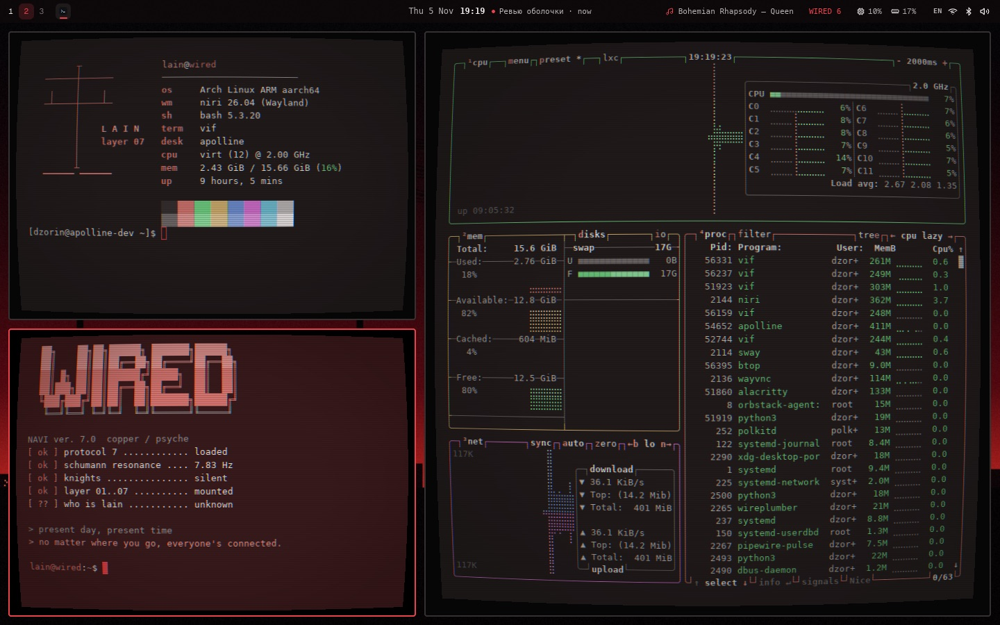
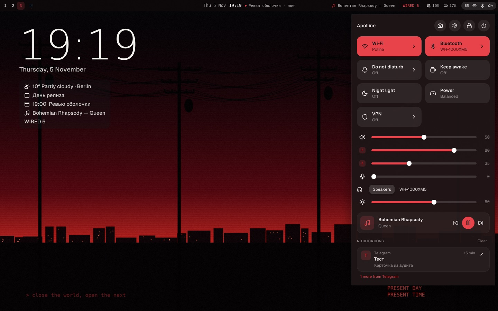

# Wired

A rice after Serial Experiments Lain: power lines against a crimson dusk, vif through a CRT, everything in the wallpaper's reds. Present day, present time.




The wallpaper is drawn by `wall.py`, not taken from the show, so it can be shared. The palette comes from it (`palette = "wallpaper"`), and vif follows Apolline's colors through `~/.cache/apolline/terminal.json`, so the terminals turn red with the rest.

## Put it on

```sh
sudo pacman -S --needed python-pillow ttf-dejavu wqy-zenhei fastfetch btop
mkdir -p ~/.config/apolline/wired ~/.local/share/apolline/wallpapers
cp wired.sh navi.sh lain.txt fetch.jsonc ~/.config/apolline/wired/
python wall.py
cp ~/.config/apolline/config.toml ~/.config/apolline/config.toml.mine
cp config.toml ~/.config/apolline/config.toml
cp vif.toml ~/.config/vif/vif.toml
```

Then the three windows, from a vif already open:

```sh
niri msg action spawn -- vif -e bash -c "fastfetch -c ~/.config/apolline/wired/fetch.jsonc; exec bash"
niri msg action set-column-width "42%"
niri msg action spawn -- vif -e sh ~/.config/apolline/wired/navi.sh
niri msg action consume-or-expel-window-left
niri msg action spawn -- vif -e btop
niri msg action set-column-width "58%"
```

btop takes the terminal's colors with `color_theme = "TTY"` and `theme_background = false` in `~/.config/btop/btop.conf`. `[bar] weather` names a city; put yours. `wired.sh` is a bar module in Waybar's JSON, so it shows on the bar and under the clock.
